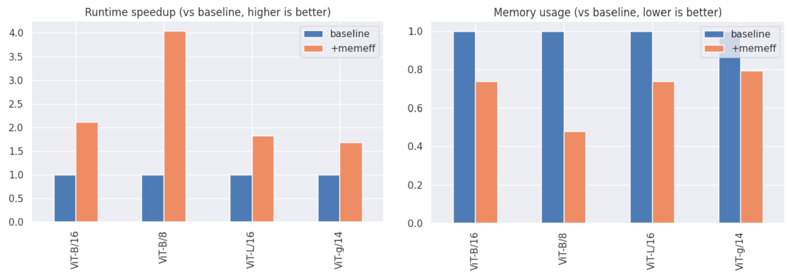

<p align="center">
  <b>English</b> · <a href="README.zh.md">简体中文</a>
</p>


[](https://colab.research.google.com/github/facebookresearch/xformers/blob/main/docs/source/xformers_mingpt.ipynb)
<br/><!--


[](https://github.com/facebookresearch/xformers/actions/workflows/gh-pages.yml/badge.svg)
-->
[](https://app.circleci.com/pipelines/github/facebookresearch/xformers/)
[](https://codecov.io/gh/facebookresearch/xformers)
[](https://github.com/psf/black)
<br/>
[](CONTRIBUTING.md)
<!--
[](https://pepy.tech/project/xformers)
-->
--------------------------------------------------------------------------------

## xFormers - Toolbox to Accelerate Research on Transformers

xFormers is:
- **Customizable building blocks**: Independent/customizable building blocks that can be used without boilerplate code. The components are domain-agnostic and xFormers is used by researchers in vision, NLP and more.
- **Research first**: xFormers contains bleeding-edge components, that are not yet available in mainstream libraries like PyTorch.
- **Built with efficiency in mind**: Because speed of iteration matters, components are as fast and memory-efficient as possible. xFormers relies on optimized kernels from [MSLK](https://github.com/meta-pytorch/MSLK), FlashAttention, PyTorch and Triton.

## Installing xFormers

xFormers is pure Python, and runs on any PyTorch 2.10+. Its attention kernels come from the [`mslk`](https://github.com/meta-pytorch/MSLK) package.

* **(RECOMMENDED) Install latest stable from the PyTorch index matching your PyTorch build**:

```bash
# Replace cu132 with the CUDA (e.g. cu130) or ROCm (e.g. rocm7.14) version of your PyTorch.
# flash-attn-3 is optional: it speeds up attention on Ampere and Hopper GPUs. It is only
# available with CUDA (on Windows: only with CUDA 12.x!), so leave it out otherwise.
pip install -U xformers mslk flash-attn-3 --index-url https://download.pytorch.org/whl/cu132
```

Each `mslk` release targets a specific PyTorch version: for mslk's native kernels to work (some ROCm backends need them), install versions of torch and mslk from the same row of its [compatibility table](https://github.com/meta-pytorch/MSLK#release-compatibility-table).

* **Install from source**:

```bash
# Install mslk from the PyTorch index matching your PyTorch build, as above
pip install mslk --index-url https://download.pytorch.org/whl/cu132
pip install -v -U git+https://github.com/facebookresearch/xformers.git@main#egg=xformers
```


## Benchmarks

**Memory-efficient MHA**

*Setup: A100 on f16, measured total time for a forward+backward pass*

Note that this is exact attention, not an approximation, just by calling [`xformers.ops.memory_efficient_attention`](https://facebookresearch.github.io/xformers/components/ops.html#xformers.ops.memory_efficient_attention)

**More benchmarks**

xFormers provides many components, and more benchmarks are available in [BENCHMARKS.md](BENCHMARKS.md).

### (Optional) Testing the installation

This command will provide information on an xFormers installation, and what kernels are built/available:

```python
python -m xformers.info
```

## Using xFormers

### Key Features

1. Optimized building blocks, beyond PyTorch primitives
   1. Memory-efficient exact attention - up to 10x faster
   2. sparse attention
   3. block-sparse attention
   4. fused softmax
   5. fused linear layer
   6. fused layer norm
   7. fused dropout(activation(x+bias))
   8. fused SwiGLU

### Install troubleshooting


* If importing `xformers.ops` warns that `mslk` could not be imported, or that its native library could not be loaded, install `mslk` from the PyTorch index matching your PyTorch build (see above). If mslk's native library can't be loaded, xFormers falls back to mslk's python-only mode, in which the default attention backends still work on CUDA.
* On Windows with CUDA 12.x, there are no `mslk` builds, but you can install mslk's python-only build from source instead (nothing is compiled). The default attention backends work with it:
  ```bat
  :: Replace cu126 with the CUDA version of your PyTorch. In PowerShell, use: $env:MSLK_PYTHON_ONLY = "1"
  pip install torch flash-attn-3 --index-url https://download.pytorch.org/whl/cu126
  set MSLK_PYTHON_ONLY=1
  pip install https://github.com/meta-pytorch/MSLK/archive/refs/heads/main.zip
  pip install -U xformers --index-url https://download.pytorch.org/whl/cu126
  ```


### License

xFormers has a BSD-style license, as found in the [LICENSE](LICENSE) file.
It includes code from the [triton-lang/kernels](https://github.com/triton-lang/kernels) repo.

## Citing xFormers

If you use xFormers in your publication, please cite it by using the following BibTeX entry.

``` bibtex
@Misc{xFormers2022,
  author =       {Benjamin Lefaudeux and Francisco Massa and Diana Liskovich and Wenhan Xiong and Vittorio Caggiano and Sean Naren and Min Xu and Jieru Hu and Marta Tintore and Susan Zhang and Patrick Labatut and Daniel Haziza and Luca Wehrstedt and Jeremy Reizenstein and Grigory Sizov},
  title =        {xFormers: A modular and hackable Transformer modelling library},
  howpublished = {\url{https://github.com/facebookresearch/xformers}},
  year =         {2022}
}
```

## Credits

The following repositories are used in xFormers, either in close to original form or as an inspiration:

* [Sputnik](https://github.com/google-research/sputnik)
* [GE-SpMM](https://github.com/hgyhungry/ge-spmm)
* [Triton](https://github.com/openai/triton)
* [LucidRain Reformer](https://github.com/lucidrains/reformer-pytorch)
* [RevTorch](https://github.com/RobinBruegger/RevTorch)
* [Nystromformer](https://github.com/mlpen/Nystromformer)
* [FairScale](https://github.com/facebookresearch/fairscale/)
* [Pytorch Image Models](https://github.com/rwightman/pytorch-image-models)
* [CUTLASS](https://github.com/nvidia/cutlass)
* [Flash-Attention](https://github.com/HazyResearch/flash-attention)
